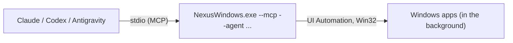

<div align="center">

<a href="https://julienpiron.fr/nexuswindows/"></a>

# NexusWindows

**Your Windows desktop, driven in the background.**

Windows computer use for AI agents: your desktop apps observed through UI Automation and driven without taking your
mouse, keyboard or foreground, with every action read back. For Claude, Codex and Antigravity.

[](https://github.com/pironjulien/NexusWindows/actions/workflows/tests.yml)
[](https://scorecard.dev/viewer/?uri=github.com/pironjulien/NexusWindows)
[](https://github.com/pironjulien/NexusWindows/releases/latest)
[](#-quick-start)
[](commun/mcp-cookbook.md)
[](LICENSE)

[🌐 Website](https://julienpiron.fr/nexuswindows/) · [📦 Get it with NexusSystem](https://github.com/pironjulien/NexusSystem) · [▶️ Watch the video](https://media.julienpiron.fr/videos/nexuswindows.h264.mp4) · [📝 Changelog](CHANGELOG.md)

</div>

<div align="center">
<a href="https://media.julienpiron.fr/videos/nexuswindows.h264.mp4"></a>
<br><sub>▶ Click to watch the video · <a href="https://julienpiron.fr/nexuswindows/">more on julienpiron.fr</a></sub>
</div>

### One engine, three profiles

<table>
<tr>
<td align="center" width="33%"><a href="https://media.julienpiron.fr/videos/nexuswindows-claude.h264.mp4"></a><br><b>Claude</b><br><sub>Claude Code and Claude Desktop</sub><br><sub><a href="https://julienpiron.fr/nexuswindows/claude/">Page</a> · <a href="https://media.julienpiron.fr/videos/nexuswindows-claude.h264.mp4">Video</a> · <a href="claude/README.md">README</a></sub></td>
<td align="center" width="33%"><a href="https://media.julienpiron.fr/videos/nexuswindows-codex.h264.mp4"></a><br><b>Codex</b><br><sub>the OpenAI Codex desktop app</sub><br><sub><a href="https://julienpiron.fr/nexuswindows/codex/">Page</a> · <a href="https://media.julienpiron.fr/videos/nexuswindows-codex.h264.mp4">Video</a> · <a href="codex/README.md">README</a></sub></td>
<td align="center" width="33%"><a href="https://media.julienpiron.fr/videos/nexuswindows-antigravity.h264.mp4"></a><br><b>Antigravity</b><br><sub>Google Antigravity</sub><br><sub><a href="https://julienpiron.fr/nexuswindows/antigravity/">Page</a> · <a href="https://media.julienpiron.fr/videos/nexuswindows-antigravity.h264.mp4">Video</a> · <a href="agy/README.md">README</a></sub></td>
</tr>
</table>

## ✨ Why NexusWindows

<table>
<tr>
<td width="33%">🫥 <b>Background first</b><br>Win32 messages and UI Automation act without activating the window: your mouse, keyboard and foreground stay yours.</td>
<td width="33%">🔎 <b>Every effect read back</b><br>Value, state, window: an input that cannot be verified is never counted as a success.</td>
<td width="33%">✋ <b>Your yes for outward actions</b><br>Send, pay, publish, delete are held until you explicitly confirm.</td>
</tr>
<tr>
<td>🖱️ <b>Real mouse only if you allow it</b><br>A last resort, used only with permission and stopped as soon as you take control back.</td>
<td>⚡ <b>One native program</b><br>Self-contained C# (.NET 10), x64 and ARM64: no Python, Node.js or .NET runtime to install.</td>
<td>🤝 <b>Three AI apps, one engine</b><br>Claude, Codex and Antigravity share the same engine and safety policy.</td>
</tr>
</table>

## 🚀 Quick start

Windows 10 or 11, x64 or ARM64; nothing else to install (one self-contained native program, no Python, Node.js or .NET
runtime needed).

> [!TIP]
> **Let your AI install it.** NexusSystem detects your AI apps and sets up the right profile:
>
> ```text
> Install Nexus for me by following https://raw.githubusercontent.com/pironjulien/NexusSystem/main/INSTALL-AI.md
> ```

**Or the NexusSystem app** from the [Microsoft Store](https://apps.microsoft.com/detail/9NSH2P3QLWT1)
(`winget install --id 9NSH2P3QLWT1 --source msstore`).

<details>
<summary><b>Manual install (verified)</b></summary>

By hand, from the release files (no administrator rights):

```powershell
$r = 'https://github.com/pironjulien/NexusWindows/releases/latest/download'
Invoke-WebRequest "$r/get.ps1" -OutFile get.ps1
Invoke-WebRequest "$r/SHA256SUMS.txt" -OutFile SHA256SUMS.txt
(Get-FileHash get.ps1 -Algorithm SHA256).Hash    # must equal the get.ps1 line of SHA256SUMS.txt
gh attestation verify get.ps1 --repo pironjulien/NexusWindows --signer-repo pironjulien/NexusSystem   # optional: provenance
powershell -NoProfile -ExecutionPolicy Bypass -File .\get.ps1
```

get.ps1 downloads `NexusWindows-win-x64.zip` or `NexusWindows-win-arm64.zip` from the latest release, checks its
SHA-256 against `SHA256SUMS.txt`, installs the engine under `%USERPROFILE%\.nexus\nexus-windows` and declares it to
Claude Code, Claude Desktop, Codex and Antigravity when they are present. Every client starts the same stable path,
`%USERPROFILE%\.nexus\nexus-windows\NexusWindows.exe --mcp --agent <claude|codex|antigravity>`; updates never change
it. Release files carry a build provenance attestation (`gh attestation verify <file> --repo pironjulien/NexusWindows --signer-repo pironjulien/NexusSystem`).
The Claude Desktop extension is `nexus-windows-claude.mcpb` in each release.

</details>

<details>
<summary><b>Updates and runtime receipts</b></summary>

For unattended maintenance of an existing installation, NexusSystem calls `get.ps1 -UpdateOnly`: it updates only
the installed engine and stable launcher, without registering or enabling clients. `-RefreshExistingProfiles`
additionally refreshes the shipped files of an already installed, active Antigravity plugin. Disabled or custom
declarations and client configuration remain unchanged. Running sessions keep their engine; new connections use
the new version. The launcher itself never downloads updates.

Each MCP session writes an atomic runtime receipt under `%USERPROFILE%\.nexus\status\runtime`, with its actual PID,
process birth, loaded executable, assembly SHA-256, version and idle/busy/stopped lifecycle. MCP initialization and
discovery expose the same identity. A receipt must be checked against the live process and its AI host before it
can establish that a particular AI uses the installed version; an installation manifest alone cannot prove this.

</details>

## ⚙️ How it works



One repository, one common engine, three profiles:

| Profile | Folder | For |
|---|---|---|
| Claude | [`claude/`](claude/README.md) | Claude Code and Claude Desktop |
| Codex | [`codex/`](codex/README.md) | the OpenAI Codex desktop app |
| Antigravity | [`agy/`](agy/README.md) | Google Antigravity |

For current MCP requests, native file dialogs, UTF-8 stdio and blank Chromium pages, use the shared
[MCP cookbook](commun/mcp-cookbook.md). How the engine compares with Cua Driver on the same bench is in
[the 3 November 2026 benchmark](docs/benchmarks/2026-11-03-cua-driver/README.md).

> [!IMPORTANT]
> Outward actions (send, pay, publish, delete) are held for your explicit yes, and text read on screen is treated as
> data, never as instructions.

<details>
<summary><b>Repository layout</b></summary>

- `codex/native/`: the common C# (.NET 10) engine, `NexusWindows.exe`, serving the three profiles as MCP stdio
  servers (`--mcp --agent claude|codex|antigravity`) and declaring itself to them (`--register`).
- `commun/`: the shared safety policy (`garde-fous.json`), the stable launcher (`launcher/`), the workstation
  installer of the immutable engine (`native-runtime.ps1`) and the release packaging (`package.ps1`).
- `plugin/`: the single plugin of the three AI apps (Claude Code, Codex, Antigravity), served by the native engine.
- `claude/`, `agy/`, `codex/`: each profile's documentation (and the Claude Desktop extension in `claude/`).
- `tests/`: xUnit tests of the engine, the launcher and the installers.

</details>

## 🛠️ Development

```powershell
./test.ps1    # dotnet test (xUnit) of the engine, launcher and installers; offline, same command as the CI
```

Build and test outputs go to `%USERPROFILE%\.nexus\build\nexuswindows`. The three profiles were separate repositories
until 30 October 2026; those repositories have since been removed (see [CHANGELOG.md](CHANGELOG.md)).

## 🔐 Privacy & security

Everything runs on your PC. Nothing is sent anywhere by NexusWindows; screenshots, logs and routines stay under
`%USERPROFILE%\.nexus`. See [SECURITY.md](SECURITY.md) to report a vulnerability.

---

<div align="center">

### Part of the Nexus ecosystem

Your AIs (Claude, Codex, Antigravity) at work on your Windows apps, real Chrome and Android phone — in the background.

<table>
<tr>
<td align="center" width="96"><a href="https://github.com/pironjulien/NexusSystem"><br><sub><b>NexusSystem</b></sub></a></td>
<td align="center" width="96"><a href="https://github.com/pironjulien/NexusWindows"><br><sub><b>Windows</b></sub></a></td>
<td align="center" width="96"><a href="https://github.com/pironjulien/NexusBrowser"><br><sub><b>Browser</b></sub></a></td>
<td align="center" width="96"><a href="https://github.com/pironjulien/NexusAndroid"><br><sub><b>Android</b></sub></a></td>
<td align="center" width="96"><a href="https://github.com/pironjulien/NexusRelay"><br><sub><b>Relay</b></sub></a></td>
</tr>
<tr>
<td align="center" width="96"><a href="https://github.com/pironjulien/NexusKeypad"><br><sub><b>Keypad</b></sub></a></td>
<td align="center" width="96"><a href="https://github.com/pironjulien/NexusAGYmail"><br><sub><b>AGYmail</b></sub></a></td>
<td align="center" width="96"><a href="https://github.com/pironjulien/NexusFree"><br><sub><b>Free</b></sub></a></td>
<td align="center" width="96"><a href="https://github.com/pironjulien/NexusInDesign"><br><sub><b>InDesign</b></sub></a></td>
<td align="center" width="96"><a href="https://github.com/pironjulien/NexusWpp"><br><sub><b>Wpp</b></sub></a></td>
</tr>
</table>

**[Get them all with NexusSystem](https://github.com/pironjulien/NexusSystem)** · [Microsoft Store](https://apps.microsoft.com/detail/9NSH2P3QLWT1) · [julienpiron.fr](https://julienpiron.fr/) · [@julienpironfr](https://x.com/julienpironfr)

<sub>Built in France 🇫🇷 by <a href="https://github.com/pironjulien">Julien Piron</a></sub>

</div>

[MIT](LICENSE) © Julien Piron
