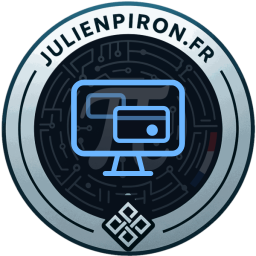
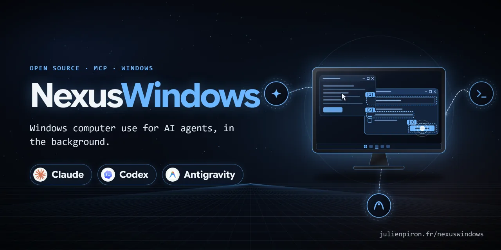
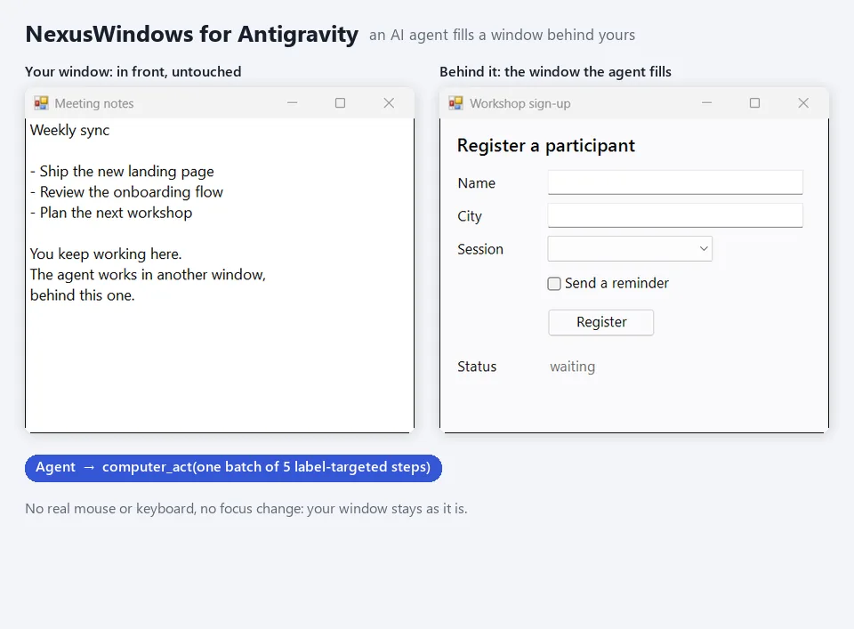

# NexusWindows for Antigravity

<!-- mcp-name: io.github.pironjulien/nexus-windows -->



[](https://github.com/pironjulien/NexusWindows/releases)
[](https://github.com/pironjulien/NexusWindows/actions/workflows/tests.yml)
[](https://github.com/pironjulien/NexusWindows/blob/main/LICENSE)
[](https://github.com/pironjulien/NexusWindows/tree/main/commun/engine)
[](https://modelcontextprotocol.io)
[](#installation)

[](https://julienpiron.fr/nexuswindows/)



**Windows computer use for Antigravity, in the background.** An MCP server (`nexus-windows`, its plugin name in the NexusSystem catalog) that lets Google
Antigravity (Gemini) see and operate Windows desktop applications while the user keeps their mouse, keyboard and
foreground window. Built for a fast model: one look, then one batch of steps with label targets, and every reply
says what to do next.

Windows 10/11 (x64, ARM64) · native .NET 10, nothing else to install · MIT licence

Part of the Nexus family: [NexusWindows](https://julienpiron.fr/nexuswindows/)
([Claude](https://github.com/pironjulien/NexusWindows) ·
[Codex](https://github.com/pironjulien/NexusWindows) ·
[Antigravity](https://github.com/pironjulien/NexusWindows)),
[NexusBrowser](https://julienpiron.fr/nexusbrowser/) ([repo](https://github.com/pironjulien/NexusBrowser)),
[NexusAndroid](https://julienpiron.fr/nexusandroid/) ([repo](https://github.com/pironjulien/NexusAndroid)).
Project page: [julienpiron.fr/nexuswindows](https://julienpiron.fr/nexuswindows/).

## Why

Screenshot-and-click computer use moves the real cursor and brings windows to the front, so the person at the PC has
to stop working while the agent acts. Most Windows applications can be driven without that: native controls accept
window messages and modern frameworks expose UI Automation. This server acts in the background first, reads the
effect back, and only falls back to the real mouse or keyboard when the step allows it (`foreground=True`).

## NexusWindows family

One native engine exposes three MCP profiles, with tools shaped for each agent. They share the same background
techniques, safeguards and read-back. Use the [MCP cookbook](../commun/mcp-cookbook.md) for current requests, native
file dialogs, UTF-8 stdio and diagnosing blank Chromium content.

| | Claude | Codex | Antigravity |
|---|---|---|---|
| Install | `get.ps1` (one engine, three profiles) | `get.ps1` | `get.ps1` |
| Package | [GitHub release](https://github.com/pironjulien/NexusWindows/releases/latest) | [GitHub release](https://github.com/pironjulien/NexusWindows/releases/latest) | [GitHub release](https://github.com/pironjulien/NexusWindows/releases/latest) |
| Tools | `windows` `look` `act` `launch` `window` `notifications` `clipboard` `logs` | same | same |
| Folder | [`claude/`](../claude/README.md) | [`codex/`](../codex/README.md) | [`agy/`](../agy/README.md) |

Every step reports ✓ verified, = already done, ~ unknown (never replayed) or ✗ failed or refused. The three share the
guardrail policy, the foreground token, the emergency stop (Ctrl+Alt+Shift+Esc), a common journal format and a common
bench.

## Installation

Windows 10 or 11, x64 or ARM64. Nothing else to install: NexusWindows is one self-contained native program
(C#, .NET 10); no Python, Node.js or .NET runtime is needed.

**Let your AI install it**: NexusSystem detects your AI apps and sets up every profile.

```text
Install Nexus for me by following https://raw.githubusercontent.com/pironjulien/NexusSystem/main/INSTALL-AI.md
```

**By hand**, from the release files (no administrator rights; the NexusSystem app does the same for you):

```powershell
$r = 'https://github.com/pironjulien/NexusWindows/releases/latest/download'
Invoke-WebRequest "$r/get.ps1" -OutFile get.ps1
Invoke-WebRequest "$r/SHA256SUMS.txt" -OutFile SHA256SUMS.txt
(Get-FileHash get.ps1 -Algorithm SHA256).Hash    # must equal the get.ps1 line of SHA256SUMS.txt
gh attestation verify get.ps1 --repo pironjulien/NexusWindows --signer-repo pironjulien/NexusSystem   # optional: provenance
powershell -NoProfile -ExecutionPolicy Bypass -File .\get.ps1
```

It downloads `NexusWindows-win-x64.zip` or `NexusWindows-win-arm64.zip` from the latest release, checks it against the
release's `SHA256SUMS.txt`, installs the engine under `%USERPROFILE%\.nexus\nexus-windows`, and declares it to Claude
Code (or its nexus-windows plugin), Claude Desktop, Codex and Antigravity when they are on the PC. Run it again to
update; sessions already running keep their version. Remove it with `-File .\get.ps1 -Remove`.
Every release file has a build provenance attestation: `gh attestation verify <file> --repo pironjulien/NexusWindows --signer-repo pironjulien/NexusSystem`.

**Claude Desktop extension**: `nexus-windows-claude.mcpb` from the
[latest release](https://github.com/pironjulien/NexusWindows/releases/latest) (Settings, Extensions, Install extension).

**By hand**: every client declares the same stable command,
`%USERPROFILE%\.nexus\nexus-windows\NexusWindows.exe --mcp --agent <claude|codex|antigravity>`, for example in
JSON (`claude_desktop_config.json`, `mcp_config.json`):

```json
{ "mcpServers": { "nexus-windows": { "command": "C:\\Users\\you\\.nexus\\nexus-windows\\NexusWindows.exe", "args": ["--mcp", "--agent", "antigravity"] } } }
```

`NexusWindows.exe --register claude|codex|antigravity|all [--check] [--remove]` writes (or checks, or removes) these
declarations; an entry of your own is never changed.

## Tools

Eight listed MCP tools (the five below, plus `notifications`, `clipboard` and `logs`), named like the other NexusWindows tools (Claude, Codex); the older names (`computer_look`,
`computer_act`, `computer_click`...) stay callable as unlisted aliases.

| Tool | Purpose |
| --- | --- |
| `windows` | Application windows (`by_app=true`: grouped by application) |
| `look` | One line per element `[N] role « name » = « value » states @x,y`, without bringing the window forward; the image only when the tree is too thin, or on request (text first: 59 % fewer tokens, same score) |
| `act` | Several steps in one call (click, type, check, uncheck, select, menu, keys...), each read back: ✓ = ~ ✗ |
| `launch` | Open an application, document, folder, script or shortcut; the opening is read back. Steam adds CEF switches on a new start and reuses an existing instance; `restart` and local `devtools` are explicit options with identity and game/port checks |
| `window` | `restore`, `minimize`, `maximize`, `bottom`, `move`, `resize`, `front` (with `foreground=True`) or `close`: close a window (UI Automation, then `WM_CLOSE`) |

Tool descriptions, server instructions, tool and parameter names and tool replies are in English.

## What it does

- **Designed for Gemini**: golden rule *look, then act in one batch with label targets*; every action reply carries
  a one-line `next` (✓ done · = already done, do not redo · ~ effect not seen, look at the attached image · ✗ failure,
  cause and what to try) and, when the effect was not read back, a WebP image of the window (common Nexus image rule:
  ≤ 2000 px and 2.56 MP, lossless up to 3 MB, then 2 or 3 low bits dropped, then JPEG at the same size, never over 3 MB; not attached again when the screen is unchanged;
  `look(zoom=box_2d)` enlarges an area for small text). An
  unknown or failed result requires a fresh `look` before deciding the remaining actions. Anti-repeat guard (the
  three profiles): the same batch resent to the same window, with no `look` of it in between and the window
  unchanged since that batch, is refused and nothing is sent; a changed window (next page, new value) lets it
  through. `repeat=true` repeats on purpose a batch that was verified (✓); it never authorizes replaying an uncertain
  (~) or failed (✗) input, which needs a `look` first.
- **Background first, even with `foreground=True`**: a `box_2d` or (x, y) target is mapped to the element under the
  point in the window's own UI Automation tree (covered windows included) and handled like a label target; a click on
  a text field *retains* it, so `type` without target, `ctrl+a`, `ctrl+v` and erase keys become background writes
  read back; plain keys are posted (`WM_KEYDOWN`/`WM_KEYUP`) in Win32, WinForms and WPF. Real mouse and keyboard only
  as a fallback with `foreground=True`; otherwise an explicit refusal (`needs_foreground`) and nothing is sent. One
  exception: a key the application ignores when posted (WPF Ctrl+K) goes by the real keyboard in a brief foreground
  lease once the user pauses, their window given back at once (1.2 to 1.4 s in front on the 9 November 2026 bench, 3.17.11);
  `fallback:false` on the step refuses it instead.
- **Per UI family**: Win32 → direct messages (`BN_CLICKED`, `BM_SETCHECK`, `EM_REPLACESEL`, `CB_SETCURSEL` /
  `LB_SETCURSEL` with their notifications, menu `WM_COMMAND`); WinForms → UI Automation then messages; WPF, UWP,
  Chromium → UI Automation only. Never UI Automation Invoke on a Win32 button (its proxy activates the window) nor
  Select on a Win32 list (silent).
- **One cross-process read**: the window-scoped UI Automation tree is read in one round trip
  (`IUIAutomationCacheRequest` + `BuildCache`, `AutoSetFocus = False`). A truncated or failed read is reported
  (`uia.status`, `warning`), never a silent empty list.
- **Read-back after every action**: `verified` true/false/None from a real read (field value, check state,
  selection, focused element, window title, image); `success` is never true on "command sent" alone. Steps accept a
  postcondition `expect` (already true: step skipped, status `already-satisfied`; false after: step failed).
  A batch stops at the first failed or refused step, before sending the next action, with no automatic replay; a step
  sent without a postcondition stops it too unless the next step names its own target or is a key after a delivered key.
  A verified postcondition establishes the effect and allows the batch to continue; an unknown effect requires
  observation before preparing the remaining steps.
- **The user's physical input via Raw Input** (injected input ignored): wait for a pause before any real mouse or
  keyboard action, and stop at the next checkpoint if the user touches keyboard or mouse (`interrupted`).
- **Guards in the code, not only in the instructions**: the window is always named (never the foreground one by
  default, ambiguous titles refused with the candidates); an ambiguous label is refused with the candidates; the
  target window is read back in the foreground right before every `SendInput`; password managers (KeePass,
  KeePassXC, Bitwarden, 1Password, Dashlane, NordPass, RoboForm, LastPass) are never looked at, captured or driven;
  the sign-in screen, lock screen and UAC prompt are refused. An action labelled pay, buy, order, transfer money,
  send, publish, delete permanently, uninstall, format, reset, cancel a subscription, erase data or make a repository
  public needs `confirm: true` on the step, and so does any key, `submit` or coordinate click that would trigger one.
  The current explicit end-to-end request or approval covers preparation and confirmation dialogs for the same
  operation: compare fresh action summaries and use fresh exact single-use tokens without another user question
  when covered. Otherwise ask at most once for the missing decision; a material scope change is separate. This
  preserves token matching/expiry and does not whitelist update buttons. Existing public extension updates retain
  their authorized package, visibility and review/automatic-publication mode; see the [approval cookbook](../commun/mcp-cookbook.md#one-user-approval-for-one-complete-operation).
- **Clipboard**: never used on its own; only the `clipboard` tool writes to it, as a loan: the user's content is set
  aside format by format and given back after 61.8 s or on `restore` (never if they copied something meanwhile).
- **Agent at work**: while an action runs (`act`, opening, closing, focusing and the action aliases; never
  the reads), a small logo spins on itself in the bottom-right corner of the driven window's screen, like a game
  loading screen (the logo and its shadow only, no halo), and goes away 1.6 s after the last action. Always on top, borderless,
  click-through, never activated, absent from the taskbar and excluded from screen captures.
  `NEXUS_WINDOWS_INDICATOR=0` turns it off.
- **Shared with the other desktop agents of the PC**: foreground token (`%USERPROFILE%\.nexus\foreground.lock`) and
  emergency stop (Ctrl+Alt+Shift+Esc, `%USERPROFILE%\.nexus\stop`), the same file protocols as
  [NexusWindows for Claude](https://github.com/pironjulien/NexusWindows/tree/main/claude#working-alongside-other-agents).

## Measurements

The current figures are in [the 9 November 2026 benchmark](https://github.com/pironjulien/NexusWindows/blob/main/docs/benchmarks/2026-11-09-cua-driver/README.md):
the common engine (3.17.10, each of the three profiles) and Cua Driver 0.44.0 on the same covered lab windows (Win32,
WinForms, WPF, Electron, Edge), the application as the judge, 116 trials each.

| 116 trials, target covered | NexusWindows 3.17.10 (each profile) | Cua Driver 0.44.0 |
|---|---|---|
| Real effect | **102** | 50 |
| False success (reported done, the app got nothing) | **0** | 16 |
| Refused before sending anything (needs the foreground) | 14 | 0 |
| Trials with an intrusion (foreground, cursor or clipboard) | 4 (WPF Ctrl+K: brief foreground lease, 1.2 to 1.4 s since 3.17.11, 3.4 to 3.9 s before; launch: activation event only, 0 ms) | 11 |

Raw results and every task are in that folder. Benchmarks of the earlier Python engine (October 2026) were retired
with it.

## Architecture

The Antigravity profile is served by the common C# (.NET 10) engine (`commun/engine/`, started as
`NexusWindows.exe --mcp --agent antigravity` through the stable launcher `commun/launcher/`), with the shared safety
policy `commun/garde-fous.json`. `plugin/antigravity/` (at the repository root) holds the Antigravity plugin and its agent guide
(`SKILL.md`), installed by `NexusWindows.exe --register antigravity`.

## Privacy

NexusWindows for Antigravity runs entirely on your PC. It has no account, no telemetry, no analytics and no network request
of its own (updates come from running get.ps1 or NexusSystem again). DevTools connections stay on `127.0.0.1`.

- **What it reads**: window titles, the UI Automation tree and window images of the applications the agent works in,
  only when a tool is called. Password managers and the secure desktop are never inspected nor driven. The OCR
  fallback uses the Windows built-in engine on the PC; no image leaves it. The `notifications` tool reads the Windows
  notification database read-only, masking security codes.
- **Where it goes**: tool results are returned to Antigravity, which may send them to Google under its own privacy policy;
  NexusWindows sends nothing anywhere else.
- **What it stores**, under `%USERPROFILE%\.nexus\`: the engine and its stable launcher (`nexus-windows\`), per-agent
  state (debug log without typed text, routines you chose to remember, throwaway browser profiles deleted
  afterwards), the shared foreground token and emergency-stop state, and a short monthly journal
  (`journal\windows\<agent>\`: app executable name, action, technique, outcome, duration; never typed text, screen
  text, labels, titles or paths).
- **Removing it**: run get.ps1 with `-Remove` (declarations removed, engine files deleted), then delete
  `%USERPROFILE%\.nexus\journal\windows` if you want the journal gone too.

Questions or concerns: open an issue on this repository.

## Limits

- Windows only. Tool descriptions, tool replies and code comments are in English.
- In the background, keyboard input is refused in UWP/WinUI and Firefox, and Ctrl/Alt shortcuts in WPF; Tk gets keys
  and shortcuts through a simulated focus (`WM_SETFOCUS` to that window only), clicks sent with the mouse button marked
  pressed for its thread, and lists scrolled through their native scroll bar;
  Chromium/Electron receives keys, shortcuts and typing through a simulated activation, checked by read-back (`~` if
  nothing changes). For web pages, [NexusBrowser](https://github.com/pironjulien/NexusBrowser) is more reliable.
- An effect with nothing readable stays `~` (not verified).
- Still refused in the background, with the cause read in each toolkit's source: WPF clicks at a point, wheel and
  shortcuts (WPF drops a click while the real cursor is not over its window); a wheel on a covered Chromium canvas
  (Chromium routes it to the window on top), or on a PARTLY visible Tk window (an entirely covered one is moved off
  screen for the wheel, then put back, since 3.4.0); a click at a point of a covered Electron page that has gone
  `hidden`.

## Development

From the repository root (the folder of `global.json`):

```powershell
./test.ps1    # dotnet test (engine, launcher, installers), offline
```

Build and test outputs go to `%USERPROFILE%\.nexus\build\nexuswindows`, never into the source tree.

## Licence

MIT, see [LICENSE](https://github.com/pironjulien/NexusWindows/blob/main/LICENSE). Copyright (c) 2026 Julien Piron.
