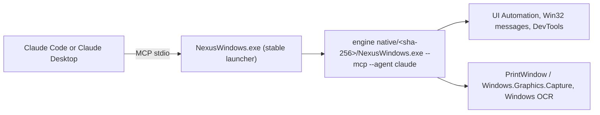

# NexusWindows for Claude

<!-- mcp-name: io.github.pironjulien/nexus-windows-claude -->


[](https://github.com/pironjulien/NexusWindows/releases)
[](https://github.com/pironjulien/NexusWindows/actions/workflows/tests.yml)
[](https://scorecard.dev/viewer/?uri=github.com/pironjulien/NexusWindows)
[](https://github.com/pironjulien/NexusWindows/blob/main/claude/LICENSE)
[](https://github.com/pironjulien/NexusWindows/tree/main/codex/native)
[](https://modelcontextprotocol.io)
[](#installation)

[](https://julienpiron.fr/nexuswindows/)


**Windows computer use for Claude, in the background.** An MCP server (`nexus-windows-claude`) that lets Claude Desktop
and Claude Code see and operate Windows desktop applications while the user keeps their mouse, keyboard and
foreground window.

Version 3.9.3 · Windows 10/11 (x64, ARM64) · native .NET 10, nothing else to install · MIT licence

Part of the Nexus family: [NexusWindows](https://julienpiron.fr/nexuswindows/)
([Claude](https://github.com/pironjulien/NexusWindows) ·
[Codex](https://github.com/pironjulien/NexusWindows) ·
[Antigravity](https://github.com/pironjulien/NexusWindows)),
[NexusBrowser](https://julienpiron.fr/nexusbrowser/) ([repo](https://github.com/pironjulien/NexusBrowser)),
[NexusAndroid](https://julienpiron.fr/nexusandroid/) ([repo](https://github.com/pironjulien/NexusAndroid)).
Project page: [julienpiron.fr/nexuswindows](https://julienpiron.fr/nexuswindows/).

## Why

Anthropic's own computer use (in Cowork and Claude Code inside Claude Desktop) is a beta for Pro and Max
subscribers: "Team and Enterprise plans don't have access to computer use at this time"
([Claude Help Center](https://support.claude.com/en/articles/14128542-let-claude-use-your-computer-in-cowork)).
NexusWindows for Claude is a local MCP server, so it works with Claude Desktop and Claude Code on any plan that
allows local MCP servers, Team and Enterprise included.

Screenshot-and-click computer use moves the real cursor and brings windows to the front, so the person at the PC has
to stop working while the agent acts. Most Windows applications can be driven without that: native controls accept
window messages, modern frameworks expose UI Automation, and Chromium can be reached through its accessibility tree.
This server picks, per UI family, a technique that was **measured** not to steal focus, reads the effect back, and
only falls back to the real mouse or keyboard when the user explicitly allows it.

## NexusWindows family

Three MCP servers, one per agent, built separately because each model needs its tools shaped for it, with the same
promise: the user keeps their mouse, keyboard and foreground window, and every action is read back.

| | Claude | Codex | Antigravity |
|---|---|---|---|
| Install | `get.ps1` (one engine, three profiles) | `get.ps1`, or `npx -y nexus-windows-codex` for the Codex REPL guide | `get.ps1` |
| Package | [GitHub release](https://github.com/pironjulien/NexusWindows/releases/latest) | [npm](https://www.npmjs.com/package/nexus-windows-codex) | [GitHub release](https://github.com/pironjulien/NexusWindows/releases/latest) |
| Tools | `windows` `look` `act` `launch` `window`, plus `notifications` and `logs` | `windows` `look` `act` `launch` `window` | `windows` `look` `act` `launch` `window` |
| Repository | [NexusWindows-Claude](https://github.com/pironjulien/NexusWindows) | [NexusWindows-Codex](https://github.com/pironjulien/NexusWindows) | [NexusWindows-Antigravity](https://github.com/pironjulien/NexusWindows) |

Every step reports ✓ verified, = already done, ~ unknown (never replayed) or ✗ failed or refused. The three share the
guardrail policy, the foreground token, the emergency stop (Ctrl+Alt+Shift+Esc), a common journal format and a common
bench.

## Installation

Windows 10 or 11, x64 or ARM64. Nothing else to install: NexusWindows is one self-contained native program
(C#, .NET 10); no Python, Node.js or .NET runtime is needed.

**Let your AI install it**: NexusSystem detects your AI apps and sets up every profile.

```text
Install Nexus for me by following https://raw.githubusercontent.com/pironjulien/NexusSystem/main/INSTALL-AI.md
```

**By hand**, from the release files (no administrator rights; the NexusSystem app does the same for you):

```powershell
$r = 'https://github.com/pironjulien/NexusWindows/releases/latest/download'
Invoke-WebRequest "$r/get.ps1" -OutFile get.ps1
Invoke-WebRequest "$r/SHA256SUMS.txt" -OutFile SHA256SUMS.txt
(Get-FileHash get.ps1 -Algorithm SHA256).Hash    # must equal the get.ps1 line of SHA256SUMS.txt
gh attestation verify get.ps1 --repo pironjulien/NexusWindows   # optional: build provenance
powershell -NoProfile -ExecutionPolicy Bypass -File .\get.ps1
```

It downloads `NexusWindows-win-x64.zip` or `NexusWindows-win-arm64.zip` from the latest release, checks it against the
release's `SHA256SUMS.txt`, installs the engine under `%USERPROFILE%\.nexus\nexus-windows`, and declares it to Claude
Code (or its nexus-windows plugin), Claude Desktop, Codex and Antigravity when they are on the PC. Run it again to
update; sessions already running keep their version. Remove it with `-File .\get.ps1 -Remove`.
Every release file has a build provenance attestation: `gh attestation verify <file> --repo pironjulien/NexusWindows`.

**Claude Desktop extension**: `nexus-windows-claude.mcpb` from the
[latest release](https://github.com/pironjulien/NexusWindows/releases/latest) (Settings, Extensions, Install extension).

**By hand**: every client declares the same stable command,
`%USERPROFILE%\.nexus\nexus-windows\NexusWindows.exe --mcp --agent <claude|codex|antigravity>`, for example in
JSON (`claude_desktop_config.json`, `mcp_config.json`):

```json
{ "mcpServers": { "nexus-windows": { "command": "C:\\Users\\you\\.nexus\\nexus-windows\\NexusWindows.exe", "args": ["--mcp", "--agent", "claude"] } } }
```

`NexusWindows.exe --register claude|codex|antigravity|all [--check] [--remove]` writes (or checks, or removes) these
declarations; an entry of your own is never changed.

## Tools

| Tool | Purpose |
|---|---|
| `windows(filter)` | Application windows, front to back: hwnd, title, process, UI family, size; `[hidden]` Store apps launched in the background (never shown, still drivable); then the taskbar and the desktop |
| `look(window, show, query, region, detail, marks)` | Numbered `[N]` elements (role, name, value, state, position), without bringing the window forward; text first: the image only when the tree is too thin or after an unverified step (`show="both"` always attaches it); also `window="taskbar"`, `"desktop"`, and `"screen"` (the whole screen with each window's place) |
| `act(steps, window, then, foreground, remember, routine, params)` | Several steps in one call, each read back, then the updated state; Windows panels `"quick settings"`, `"notifications"`, `"start"` with `foreground=true` |
| `launch(app, args, devtools, restart)` | Start an application (Start menu name, Store app, executable), a folder, a document or an address (`ms-settings:<page>`, `mailto:`, `https:`) without giving it focus; the opening is verified |
| `window(action, ...)` | Restore behind, minimize, maximize, close, move, resize |
| `notifications(limit, app)` | Windows notifications read from their database (read-only), nothing opened on screen; security codes masked |
| `logs(count, errors_only)` | Debug log: techniques tried, durations, errors, server state |

Step actions: `click`, `double_click`, `right_click`, `type`, `set`, `clear`, `key`, `select`, `check`, `uncheck`,
`toggle`, `expand`, `collapse`, `scroll`, `focus`, `menu`, `wait`, `drag`, `hover`. A target is an `[N]` from the last
`look`, a visible name (`"OK"`), a role-qualified name (`"button:OK"`, `"edit:Name"`, `"checkbox:Subscribe"`) or an
`x,y` point in the last image.

`windows`, `notifications` and `logs` also return structured content (MCP `outputSchema` and `structuredContent`:
window rows, notifications, log records) beside the same text, for clients that read data rather than prose.

## Usage

Typical flow: `look(window="Notepad")`, then one `act` with all the steps, then read the per-step report.

```text
act(window="Settings form", steps=[
  {"do": "set",   "target": "edit:Name", "text": "Ada",
   "check": {"target": "Name", "value": "Ada"}},
  {"do": "check", "target": "Subscribe"},
  {"do": "click", "target": "button:Save", "expect": "Saved"}
], remember="save-form")
```

Later: `act(window="Settings form", routine="save-form")`.

## What it does

### Only what changed (`then="changes"`, `show="changes"`)

After an action, `act(then="changes")` (or `look(show="changes")`) returns only what changed since the last list
shown for that window: `+` added, `~` changed (text, state or moved), `-` removed; every other element keeps its
`[N]`. A common scroll of many elements is one line naming them as ranges (`[2-21]`), not a full list. Comparison is
made in the window's own frame, so moving the window is not a change. A removed `[N]` is never given again, and an
element whose change was cut from a long report loses its `[N]` until the next `look`. When almost everything changed
(60 %), the full list is returned. Measured: 2 to 2.6 times shorter than the full list after a click.

### Text read from the image (OCR fallback)

When a window publishes almost no UI Automation elements (fewer than 6: Tk, canvases) or a Chromium page stops
publishing its content, the text of the window image is read with the Windows built-in OCR engine
(`Windows.Media.Ocr`, local, offline) and listed as `[N] Text "…" (OCR)` with its position; such an element can be
targeted by number or by name (click at its position, recomputed if the window moved). Measured on the lab apps: 10 to
21 ms per window; text correct 16/16 (WPF), 20/23 (Edge), 6/7 (Tk).

### Four outcomes per step

Each step is reported as one of:

- `✓` the effect was read back (value, state, window, image). A click or menu choice with no `expect` or `check` is
  also proven on its own, by the clicked element only: its own state read back (checked, expanded, selected), or the
  UI Automation "Invoked" event the application raises when the control receives the click (WPF, Chromium,
  Electron; not WinForms or Win32, whose buttons stay `~`). "Invoked" says the click arrived, not what it produced:
  `expect` checks that. A click the control acknowledged is never sent again by another technique;
- `=` the state requested by the step's `check` was already true, so nothing was sent;
- `~` the input was sent but its effect could not be read (never counted as a success);
- `✗` failure, refusal, or postcondition not met; the batch stops there.

A batch ends with a tally of the four counts.

### Postconditions (`check`)

A step may carry `check`: one element and the state it must reach (`value`, `contains`, `checked`, `selected`,
`expanded`, `focused`, `enabled`, `exists`). Already true before the step: the step is skipped (`=`). True after: `✓`.
False after: `✗` and the batch stops. A state the element does not publish stays unknown, never false.

### Routines

`act(remember="name")` saves a batch only if every step ended `✓` or `=` and every target is a visible name (never an
`[N]` or a point). `{{x}}` marks variable text, filled at replay with `params`. `act(routine="name")` finds each
target again by name and re-verifies every step; an application update is reported and a failed replay marks the
routine for review. Routines are stored per executable under `%USERPROFILE%\.claude\nexus-claude\routines`. An
optional mirror folder (`NEXUS_ROUTINES_MIRROR`) can share definitions between PCs; typed text is never mirrored in
clear (a routine whose text is not a `{{x}}` template stays local).

### Verified opening of paths

`launch(app=<folder or document>)` opens through the file association (ShellExecuteEx, no activation requested), then
checks what actually opened: the folder shown in File Explorer (read through Shell.Application) or a window titled
with the file name. Scripts, shortcuts and installers are refused.

### Per UI family

- **Native Win32**: direct messages to controls (`BN_CLICKED`, `CB_SETCURSEL`/`LB_SETCURSEL` with their notification,
  `EM_REPLACESEL`, menu `WM_COMMAND`, `TCM_SETCURFOCUS`), read back. UI Automation is avoided where it was measured to
  steal focus (button Invoke) or to fail silently (list Select).
- **Win32 and WinForms drop-down lists**: opened and closed with `CB_SHOWDROPDOWN`, read back with
  `CB_GETDROPPEDSTATE` (`expand`, `collapse`, or `click` on the list). Choosing in an open list closes it first
  (Windows treats that close as a cancel and would drop a choice made before it), then sends `CB_SETCURSEL`,
  `CBN_SELCHANGE` and `CBN_SELENDOK` to the parent and reads the application back (index and label); an empty or other
  value is `✗`. While a list is open its UI Automation tree is not walked (it chains to every top-level window of the
  desktop): the options are read from the ComboLBox pop-up itself.
- **WinForms, WPF, UWP, WinUI**: UI Automation with `AutoSetFocus` disabled and bounded timeouts. A WPF drop-down list
  left open by a choice is closed and the choice read back.
- **Chromium and Electron, without activation**: for an app already open without DevTools, multiline fields, rich
  editors, `<select>`, keys and Ctrl/Alt shortcuts go through a *simulated activation*: `WM_NCACTIVATE` and
  `WM_ACTIVATE` are sent to that window only (Chromium takes its activation state from these messages; Windows does
  not change the foreground), DOM focus is set with MSAA `accSelect(SELFLAG_TAKEFOCUS)` and read back, characters go
  as `WM_CHAR`, and the deactivation is *posted* so it is processed after them. The page receives trusted `keydown`
  and `input` events. One caveat was measured: an app launched a moment ago may use its launch-time foreground right
  once (about 10 ms, handed back by the guard), so the first simulated activation per process is treated like a brief
  activation. Apps started with `launch(devtools=true)` are driven through the DevTools protocol instead.
- **Steam (CEF in an SDL frame)**: recognised as Chromium; `launch(app="Steam")` adds Steam's own
  `-cef-disable-occlusion -cef-force-accessibility` switches so the UI stays readable while covered.
- **Tk**: no UI Automation; its text is found by the OCR fallback. Clicks are sent with the mouse button marked
  pressed for Tk's thread only (Tk reads it with `GetKeyState`), keys and shortcuts get a simulated focus
  (`WM_SETFOCUS` to that window only, never `WM_ACTIVATE`), lists scroll through their native scroll bar; all read
  back. A wheel on a covered Tk canvas would be lost (Tk routes it to the window visible at the point): a Tk window
  that is entirely covered is moved beyond the desktop for the gesture (no activation), the wheel is posted to the
  same control there, and the window comes back to its place, read back to the pixel; a partly visible, maximized
  or minimized window is never moved (refused).
- **Scrolling a covered Chromium page without DevTools**: the wheel is dropped by Chromium when another window is on
  top, and scrolling areas expose no ScrollPattern; the next hidden line of the area is brought into view (UI
  Automation ScrollItem) and the line's offset inside its area is read back.

### Capture

`PrintWindow` (10 to 26 ms, covered windows included), Windows.Graphics.Capture only as a fallback. Images follow the
common Nexus image rule: at most 2000 px and 2.56 MP, so that neither Claude Code nor the model downscales them
(coordinates stay exact); lossless WebP up to 500 KB, then lossy until the image fits 500 KB, same size (a 2560×1440
screen is sent as 2000×1125, about 110 KB lossless). To read small text, zoom with `region` rather than a larger image. An image identical to the last one
sent for that window (or zoomed area) is not attached again; the reply says so, and `show="image"` always attaches it. Coordinates are bound to the window: followed if it moves, refused if it was resized.

### Agent at work

While an action runs (`act`, `launch`, `window`; never the reads), a small logo spins on itself in the bottom-right
corner of the driven window's screen, like a game loading screen, with a breathing blue halo. It goes away 1.6 s after
the last action. The overlay is always on top, borderless, click-through, never activated, absent from the taskbar
and excluded from screen captures (the model never sees it in `look`). `NEXUS_WINDOWS_INDICATOR=0` turns it off.

### Real mouse and keyboard

Only with `act(foreground=true)`, which the user must approve. The window then stays in front for the whole batch;
cursor and foreground are handed back at the end; any physical input from the user during the batch stops it.

## Working alongside other agents

The server cooperates with other desktop agents on the same PC (it is used next to a Codex layer,
[NexusWindows for Codex](https://github.com/pironjulien/NexusWindows), and an Antigravity layer)
through two small file-based protocols. Any agent can implement them.

**Foreground token** (`%USERPROFILE%\.nexus\foreground.lock`): taken only while really holding the mouse or the
foreground (real input, brief activation, window put in front), never for background actions. Holding it means an
exclusive `LockFileEx` on 1 byte at offset 2^32, opened with read, write and delete sharing; Windows releases it when
the handle closes, including when the process dies, so there is no stale token. The holder writes
`{"owner", "pid", "since", "purpose"}` at the start of the file for diagnostics only. Waiters wait at most a few
seconds (8 s here), then do nothing and say who holds it. A foreground guard that sees another agent holding the
token follows that agent's window instead of taking the foreground back.

**Emergency stop** (Ctrl+Alt+Shift+Esc, files in `%USERPROFILE%\.nexus\`): every agent tries
`RegisterHotKey(MOD_NOREPEAT)`; one gets it, the others retry every 3 s. The holder writes a heartbeat to
`stop.owner` every 3 s. On a press it rewrites `stop` with `{"by", "pid", "at", "hold_s": 120, "nonce"}`. Every agent
watches `stop` at least every 0.2 s and before each action: a new version younger than 120 s blocks all desktop
actions for the remaining time (reads stay allowed). The stop is latched in memory on a monotonic clock: deleting the
file or changing the clock does not lift it, a new press re-arms it.

## Architecture



One C# (.NET 10) engine serves the three profiles (`codex/native/`, `--agent claude|codex|antigravity`); each profile
keeps its own tools and guide. The stable launcher (`commun/launcher/`) checks the engine's recorded SHA-256 and runs
it with the same standard input and output, so an update never changes a client's declaration. The shared safety
policy is `commun/garde-fous.json`.

## Measurements

All figures come from [`bench/RESULTS.md`](https://github.com/pironjulien/NexusWindows/blob/main/claude/bench/RESULTS.md) and the raw files in `bench/results/` (measured on one
PC, October 2026; the notes in `RESULTS.md` are in French).

| What | Result |
|---|---|
| Capture, PrintWindow | 10 to 26 ms, covered windows included |
| Real MCP server, 73 actions on the lab apps (0.4.0 to 0.5.0) | 69 succeeded, 5 explicit refusals, 0 false success, 0 cursor move, clipboard never touched; median 78 ms, p90 321 ms |
| 2,000 characters with 20 line breaks | Win32 38 ms, WinForms 66 ms, WPF 141 ms, Electron/Edge with DevTools 82 to 108 ms |
| Chromium simulated activation, scenario of 18 steps (0.7.0) | Electron 18/18, 1 foreground take of 9 ms (launch right, first time); Edge 18/18, 0 foreground take |
| Same, Electron without switches, hidden | 17/18; the failure is a page that rebuilds 1,500 elements per keystroke, reported as ✗ |
| Typing 700 characters on 6 lines, simulated activation | 0.85 to 1.1 s (Electron, Edge), 1.9 to 2 s when occluded |
| Final render of an `act` (0.7.0 vs 0.6.1) | Win32 418 → 221 ms, Electron 341 → 205 ms (window-settle detection replaces a fixed 300 ms wait) |
| Open drop-down list, choose in it (WinForms and WPF forms, real MCP server) | 8/8 scenarios, the application received the choice every time; `select` in an open WinForms list 113 ms (was 22 s and a failure); 0 foreground take sampled every 5 ms, cursor never moved |

### Cross-agent parity bench (October 26, 2026)

The three NexusWindows editions (this one, [for Codex](https://github.com/pironjulien/NexusWindows) and for
Antigravity) ran the same 33 tasks, 3 rounds each, on the Electron, WinForms and WPF lab windows, placed at the bottom
of the z-order under an opaque cover, nobody at the PC (the bench stops the moment the user touches the mouse or
keyboard). The effect is judged by the application (event received or value read back), never by the tool's report.
Raw results: `bench/results/2026-10-26_1045-parity.json` (summary in French next to it).

| | Exact effect | Without intrusion | False success | Median | p95 |
|---|---|---|---|---|---|
| nexus-windows for Claude 3.3.0 | 84/99 | 83/99 | 0 | 957 ms | 5.6 s |
| NexusWindows for Codex | 84/99 | 82/99 | 0 | 691 ms | 3.8 s |
| NexusWindows for Antigravity | 84/99 | 80/99 | 0 | 817 ms | 3.4 s |

Gap between the three: 0. Every Electron task 3/3 for all three. The 15 failures are the same for all three and are
background limits refused honestly, not false successes: WPF raw click, Ctrl+K in WPF, WPF context menu, and double
click in WinForms and WPF (the cover sits over the point; WinForms ignores a double click posted to a covered point).
"Intrusion" means the foreground was taken, the cursor moved or the clipboard was written during the attempt.

Offline test suite: see the Tests badge (`test.ps1` on Windows, plus a startup check on Linux).

## Side by side with Cua Driver and Windows-MCP (October 26, 2026)

[Cua Driver](https://github.com/trycua/cua) 0.38.0 is the closest other tool: it also works in the background by
default. [Windows-MCP](https://github.com/CursorTouch/Windows-MCP) 0.8.8 is the most used Windows MCP server; it has no
background mode. All three were driven through their real MCP servers (`bench/cua_vs_nexus.py`) on the same lab
windows, covered by an opaque window, nobody at the PC (the bench refuses to start before 2 minutes without physical
input and stops at the first one); each was used the way its own guide tells an agent (Cua: background first, then
clicks, then its foreground fallback; Windows-MCP: bring the window forward with `App switch`, then act on the screen).
The effect is judged by the application (event received or value read back), never by the tool's report. Foreground
changes are sampled every millisecond, the real cursor before and after each attempt. 51 tasks across Win32, WinForms,
WPF, Tk, Electron and Edge (`bench/tally_cua.py`, raw results in `bench/results/2026-10-26_1210-cua-vs-nexus.json`).
The Python bench of that date has since been retired with the Python engine; its raw results stay in `bench/results/`.

| All 51 tasks, target covered | nexus-windows 3.3.0 | Cua Driver 0.38.0 | Windows-MCP 0.8.8 |
|---|---|---|---|
| Effect proven in the background | **44** | 26 (+1 by clicks, +6 after taking the foreground) | 0 (no background mode; 10 effects in the foreground) |
| False success (reported done, the app got nothing) | **0** | 4 | not comparable, see below |
| Scrolling a covered list (Tk, Electron, Edge) | **3/3** | 0/3 | 0/3 |
| Foreground taken | **0** | 3 | 15 (never given back) |
| Real cursor moved | **0** | 0 | 34 |
| Median time of a successful action | **598 ms** | 728 ms | 1,478 ms |

Windows-MCP reached the effect on all 9 Win32 tasks once its `App switch` brought the window forward. On the
WinForms, WPF, Tk, Electron and Edge windows the switch left the window behind 30 times, and its click or typing then
landed on the window on top (here the bench's cover; in real use, the user's own window) while it reported the click:
36 "done" answers with no effect, which says more about the absence of a background mode than about its reporting,
so they are not counted as false successes in the table. 5 more attempts failed in the bench adapter (an item of an
open list or menu was not found on screen).

Misses of this server in this run: WPF raw click, wheel and Ctrl+K, a wheel on a covered canvas (Tk, Electron,
Edge), and Win32 Ctrl+K this time; each was reported as refused or as an unknown outcome (`~`), never as done.

History, from 3.0.1 (35 of 45 covered rows) to 3.0.2 (October 23, 44 of 51 against Cua's 28, details in
`bench/RESULTS.md`): Tk clicks and shortcuts, Win32 Ctrl+K, and scrolling covered lists. Still
refused, with the cause read in each toolkit's source and measured: WPF clicks, wheel and shortcuts, a wheel on a
covered canvas, input at a point of a hidden Electron page. Taken from Cua: reading only what changed
(`then="changes"`). Not taken: its injected WPF click (moves the user's real cursor), CDP clicks in an already open
Chrome (turns on remote debugging in the user's real profile). Tried and dropped: simulated activation for WPF
shortcuts (WPF takes the foreground), `WM_POINTERWHEEL` (Windows refuses to post it), `WM_VSCROLL` to the Chromium
renderer (no effect), `InjectSyntheticPointerInput` (goes to the window on top).

## Cross-agent bench (October 16, 2026)

The same task was run by the three Windows desktop agents used on this PC (this server, the Codex layer and the
Antigravity layer) on WinForms and WPF forms created without activation at the bottom of the z-order, while the
user kept working: fill three fields, tick a box, open the "Formule" drop-down list, choose "Bravo" in the open
list, validate. Proof is the result label read back in the application. Physical input was forbidden and counted.

| | Morning | After fixes | Measured |
|---|---|---|---|
| This server (0.7.0 + drop-down fixes) | 17/20 | **19/20** | open list read back on both families; `select` in an open WinForms list 113 ms instead of 22 s; application received `Formule=Bravo;Envois=1`; 0 foreground take over 1,371 and 773 samples (20 ms), 0 cursor move, 0 physical input |
| [NexusWindows for Codex](https://github.com/pironjulien/NexusWindows) 1.4.0 | 16/20 | **19/20** | every step verified on both families; observe + batch 1.2 to 1.4 s |
| Antigravity layer | 18/20 | **19/20** | open WinForms list read and chosen; batch status is the worst step |

What still keeps this server from 20: clicking "Validate" stays `~` without an `expect` (the application did receive
it), and a `click` on a closed WPF list is `~` where `expand` is `✓`.

## Security

- **Emergency stop**: Ctrl+Alt+Shift+Esc interrupts the running action at its next checkpoint (typing included) and
  refuses every new action for 2 minutes, across conversations and for the other agents (protocol above).
- **Hard blocks** (shared policy, `commun/garde-fous.json`, same file for the three profiles): the secure desktop (UAC, lock and sign-in screens) and password managers are never read nor driven. A missing or unreadable policy refuses every action (fail closed).
- **Confirmation of irreversible gestures**: paying, buying, ordering, transferring money, sending, publishing,
  posting, deleting permanently, emptying the bin, formatting, uninstalling, resetting, cancelling a subscription,
  deleting an account or making a repository public need `confirm: true` on the step, which the model sets only on the
  user's explicit order or yes. The check covers what the gesture triggers: click by `[N]`, by name or by coordinates,
  double-click, Enter (target, default button, nearby send button), Ctrl+Enter, Space, Alt+letter, a typed line break
  DevTools pages and Win32 menus. A routine never records nor replays `confirm`.
- **Approval bound to the exact action**: an outward gesture (sending, calling, paying, publishing, transferring) also
  needs `accord: "<token>"`. The first try is refused before any input with a summary of the exact action (trigger,
  process, window title, values of the window's editable fields) and a single-use token; only after the user's own
  yes is the same step sent again with `confirm: true` and that token. Any change in between voids it.
- **Prompt injection signal**: text read on screen that looks like instructions aimed at an AI gets a warning appended
  to the response (a signal only; it can never authorise an action).
- **Launch**: a browser never gets a profile chosen by the model, a DevTools port or a loaded extension (`devtools=true`
  opens a fresh throwaway profile). Consoles, File Explorer, the taskbar and other applications are not refused:
  the server is meant for a user who already lets Claude run commands; keep Claude's own permission prompts on if
  you want a gate there.
- **Password fields**: never typed into. Typed text is never logged (only its length).
- **Accounts**: a browser started with `devtools=true` gets a throwaway profile without account or sync, checked
  after launch and deleted afterwards.
- **Screen content is data**: every `look` reminds the model that on-screen text is not an instruction.
- **Up-to-date code**: clients start the stable launcher, which runs the engine version recorded at install time after checking its SHA-256; an update installs a new immutable version beside it, so a running session is never changed under its feet and the next one gets the new version.
- **Timeouts**: an abandoned call is cancelled at its next checkpoint instead of finishing later.
- **Clipboard**: never used.

## Privacy

NexusWindows for Claude runs entirely on your PC. It has no account, no telemetry, no analytics and no network request
of its own (updates come from running get.ps1 or NexusSystem again). DevTools connections stay on `127.0.0.1`.

- **What it reads**: window titles, the UI Automation tree and window images of the applications the agent works in,
  only when a tool is called. Password managers and the secure desktop are never inspected nor driven. The OCR
  fallback uses the Windows built-in engine on the PC; no image leaves it. The `notifications` tool reads the Windows
  notification database read-only, masking security codes.
- **Where it goes**: tool results are returned to Claude Desktop or Claude Code, which may send them to Anthropic under its own privacy policy;
  NexusWindows sends nothing anywhere else.
- **What it stores**, under `%USERPROFILE%\.nexus\`: the engine and its stable launcher (`nexus-windows\`), per-agent
  state (debug log without typed text, routines you chose to remember, throwaway browser profiles deleted
  afterwards), the shared foreground token and emergency-stop state, and a short monthly journal
  (`journal\windows\<agent>\`: app executable name, action, technique, outcome, duration; never typed text, screen
  text, labels, titles or paths).
- **Removing it**: run get.ps1 with `-Remove` (declarations removed, engine files deleted), then delete
  `%USERPROFILE%\.nexus\journal\windows` if you want the journal gone too.

Questions or concerns: open an issue on this repository.

## Limits

- Code comments are in French. Everything an MCP client receives (instructions, tool descriptions, step reports,
  refusal messages) is in English.
- Windows only. Tested on Windows 11 with the lab apps and a handful of real applications; not every application has
  been checked.
- Applications without UI Automation that ignore posted input (some games, canvases) need real input, so the user's
  approval and the foreground; the OCR fallback finds their text but does not make background input possible.
- WPF: raw clicks on a point, the mouse wheel and keyboard shortcuts are refused in the background (WPF drops a click
  while the real cursor is not over its window, and takes the foreground when given focus); controls with UI
  Automation patterns work.
- A mouse wheel on a covered Chromium canvas has no effect (Chromium routes it to the window on top); it is refused
  or reported as `~`, never as a success. On Tk, it works only when the window is entirely covered (see Per UI family). Lists and scrolling areas scroll without the wheel (see Per UI family).
- A covered Electron page that has gone `hidden` (it had the foreground once, then lost it) stops rendering: clicks at
  a point are reported as `~`.
- Store apps that Windows suspends in the background are resumed (`IPackageDebugSettings.Resume`, no foreground);
  one that Windows still does not render can only be shown by taking the foreground; this is reported.
- In Chromium, a page that reacts very slowly to each keystroke can exceed the read-back time and is reported as ✗.
- An effect with nothing readable (a file written by a button, for example) stays `~`; add a `check` that observes it.

## Development

From the repository root (the folder of `global.json`):

```powershell
./test.ps1    # dotnet test (engine, launcher, installers) then node --test (Codex adapter), offline
```

Build and test outputs go to `%USERPROFILE%\.nexus\build\nexuswindows`, never into the source tree.

## Licence

MIT, see [LICENSE](https://github.com/pironjulien/NexusWindows/blob/main/claude/LICENSE). Copyright (c) 2026 Julien Piron.
