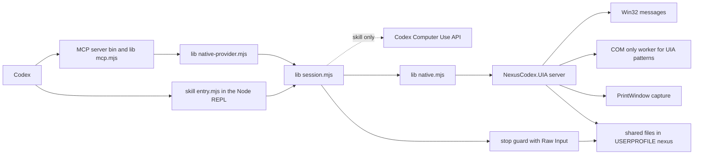

# NexusWindows for Codex

<!-- mcp-name: io.github.pironjulien/nexus-windows-codex -->


[](https://github.com/pironjulien/NexusWindows/releases)
[](https://github.com/pironjulien/NexusWindows/actions/workflows/tests.yml)
[](https://github.com/pironjulien/NexusWindows/blob/main/codex/LICENSE)
[](https://github.com/pironjulien/NexusWindows/blob/main/codex/package.json)
[](https://github.com/pironjulien/NexusWindows/tree/main/codex/native)
[](#installation)

[](https://julienpiron.fr/nexuswindows/)

**Windows computer use for Codex, in the background.** A native MCP profile (`nexus-windows-codex`) that
lets OpenAI Codex see and operate Windows desktop applications while the user keeps their mouse, keyboard and
foreground window. Codex's own Computer Use came to macOS first; on Windows, OpenAI's documentation says to keep the
target app visible on the active desktop while it runs ([Codex docs](https://developers.openai.com/codex/app/computer-use)).
NexusWindows for Codex has its own local .NET helper for everything: window inventory, UI Automation tree, PrintWindow
capture of covered windows, Win32 messages and UI Automation patterns without focus, and its own real mouse and
keyboard as the last resort, under a shared foreground token. Every action is judged from the application's real
state, and a batch needs an explicit postcondition per step. It also ships as a Codex skill that layers the same session over Codex's Computer Use API (`@oai/sky`).

Version 3.9.2 · Windows 10/11 (x64, ARM64) · native .NET 10, nothing else to install · Node 22+ for the optional REPL guide · MIT licence

Part of the Nexus family: [NexusWindows](https://julienpiron.fr/nexuswindows/)
([Claude](https://github.com/pironjulien/NexusWindows) ·
[Codex](https://github.com/pironjulien/NexusWindows) ·
[Antigravity](https://github.com/pironjulien/NexusWindows)),
[NexusBrowser](https://julienpiron.fr/nexusbrowser/) ([repo](https://github.com/pironjulien/NexusBrowser)),
[NexusAndroid](https://julienpiron.fr/nexusandroid/) ([repo](https://github.com/pironjulien/NexusAndroid)).
Project page: [julienpiron.fr/nexuswindows](https://julienpiron.fr/nexuswindows/).

## Why

Codex's built-in Computer Use acts with the physical mouse and keyboard: it brings the target window to the front and
the user has to stop working while it acts. Many Windows applications can be driven without that. NexusWindows for
Codex tries the background techniques first, judges the result from the application's real state, and only uses its
helper's real mouse and keyboard as a fallback, after a pause in the user's own typing and under a token shared with
the other agents on the PC.

The MCP profile uses the common self-contained .NET engine: no listening network port and no private Electron API.
The optional Node adapter and skill run the session in Codex's Node REPL over its Computer Use API.

## NexusWindows family

One native engine exposes three MCP profiles, with tools shaped for each agent. They share the same background
techniques, safeguards and read-back. Use the [MCP cookbook](../commun/mcp-cookbook.md) for current requests, native
file dialogs, UTF-8 stdio and diagnosing blank Chromium content.

| | Claude | Codex | Antigravity |
|---|---|---|---|
| Install | `get.ps1` (one engine, three profiles) | `get.ps1` | `get.ps1` |
| Package | [GitHub release](https://github.com/pironjulien/NexusWindows/releases/latest) | [GitHub release](https://github.com/pironjulien/NexusWindows/releases/latest) | [GitHub release](https://github.com/pironjulien/NexusWindows/releases/latest) |
| Tools | `windows` `look` `act` `launch` `window`, plus `notifications` and `logs` | `windows` `look` `act` `launch` `window` | `windows` `look` `act` `launch` `window` |
| Folder | [`claude/`](../claude/README.md) | [`codex/`](../codex/README.md) | [`agy/`](../agy/README.md) |

Every step reports ✓ verified, = already done, ~ unknown (never replayed) or ✗ failed or refused. The three share the
guardrail policy, the foreground token, the emergency stop (Ctrl+Alt+Shift+Esc), a common journal format and a common
bench.

## Installation

Windows 10 or 11 and the [Codex app](https://openai.com/codex/) (or the Codex CLI).

**Recommended**: the native engine, nothing else to install. Use the
[NexusSystem app](https://apps.microsoft.com/detail/9NSH2P3QLWT1) from the Microsoft Store, or the release files
(see the [main README](../README.md#install)): `get.ps1`, checked against `SHA256SUMS.txt` and run with
`powershell -NoProfile -ExecutionPolicy Bypass -File .\get.ps1`, declares
`%USERPROFILE%\.nexus\nexus-windows\NexusWindows.exe --mcp --agent codex` in Codex `config.toml`.

**By hand**: Codex declares the same stable command as the other clients, in `~/.codex/config.toml` (shared by the
Codex app, CLI and IDE extension):

```toml
[mcp_servers.nexus-windows]
command = 'C:\Users\you\.nexus\nexus-windows\NexusWindows.exe'
args = ["--mcp", "--agent", "codex"]
```

`NexusWindows.exe --register codex [--check] [--remove]` writes (or checks, or removes) this declaration; an entry of
your own is never changed. Restart Codex, then ask: "Open Notepad and write a shopping list: milk, eggs, bread."
Updates replace the engine behind the same path: running sessions keep their version, new ones get the new one.
The Codex plugin (this profile's guide and skill) comes from the NexusSystem plugin catalog, which NexusSystem adds
to Codex for you.

### Codex skill (alternative, from a clone)

The skill runs the same session inside Codex's Node REPL and can fall back on Codex's Computer Use API. It needs the
Codex desktop app with its Computer Use plugin and the .NET 10 SDK:

```powershell
git clone https://github.com/pironjulien/NexusWindows.git
cd NexusWindows\codex
pwsh -NoProfile -File install.ps1             # build the helper and install the guide, reusing an enabled plugin
pwsh -NoProfile -File install.ps1 -CheckOnly  # verify the installation matches the sources
```

`install.ps1` keeps versioned helper builds under `%LOCALAPPDATA%\NexusCodex\ComputerUse` (or `-StateRoot`), writes a
source-linked `entry.mjs` next to the skill (so keep the clone where it is), checks the four .NET runtime files by
hash, and serialises concurrent installations. `CODEX_HOME` or `-CodexHome` changes the Codex folder. Re-run it after
updating the clone. Note: the build path must stay under the Windows 260-character limit. The MCP server also finds
this helper when it runs from a clone.

With the plugin enabled, the clone installer reuses its packaged guide and entry;
an earlier standalone guide installed by NexusWindows is archived under the Codex `backups` folder.

The skill is picked up by new Codex sessions. A REPL that already imported an older version must be reset, because
the JavaScript module cache does not reload.

## Tools

| Tool | Purpose |
|---|---|
| `windows(filter)` | Application windows (id, app, title, pid), like the taskbar, plus open dialogs with `dialogOf` (their owner); password managers never listed |
| `look(window, mode, region, marks)` | One window by id or a unique part of its title or app: UI Automation tree, plus a capture that works on covered windows with `mode="image"` or `"both"`; `region` zooms on an area of the last image (`image`: that image's screenshotId); `marks` draws tree line numbers on the image; selects the window for `act` |
| `act(observation, steps)` | One step, or up to 32 each with its own `expect`, on the observation id returned by `look` (or by the previous `act`); refused once another `look` replaced it; stops at the first step not verified |
| `launch(app)` | Start an application (name, path, Store app id), a folder, a document or a Settings page (`ms-settings:`) and give the foreground back |
| `window(action, window)` | `action="close"`: one close message, read back; a "save?" prompt is reported, never answered |

Step kinds: `click` (selector, or point and native capture id; `button`, `count`), `setValue`, `typeText`, `key`,
`select`, `menu`, `secondary`, `scroll`, `drag`, `hover` (one mouse move, no button). Each step reports ✓ verified, = already done, ~ unknown (look again,
never replayed) or ✗ failed or refused.

`windows`, `launch` and `window` also return structured content (MCP `outputSchema` and `structuredContent`: the
window list, the launch or close result) beside the same text, for clients that read data rather than prose.

## Usage

As an MCP server: `windows`, then `look` at one window, then `act` with selectors from that look and an `expect`
that proves the effect. An observation serves one `act` and expires after 60 s. From MCP protocol 2026-07-28 (stateless
MCP), `look` and `window` need a named window and `act` the observation id, `region` its `image`, and every image is attached (never
"unchanged, not attached again"): nothing is carried over implicitly from another call, so two conversations sharing the server never act on each other's window.

As a skill, the agent follows [SKILL.md](https://github.com/pironjulien/NexusWindows/blob/main/codex/skills/nexus-windows/SKILL.md) and the [API reference](https://github.com/pironjulien/NexusWindows/blob/main/codex/skills/nexus-windows/references/api.md).
In Codex's Node REPL:

```js
if (!globalThis.sky) { const { sky } = await import('@oai/sky'); globalThis.sky = sky; }
const home = nodeRepl.homeDir ?? (await import('node:os')).homedir();
globalThis.nexusWindows = await import('file:///' + home.replaceAll('\\', '/') + '/.codex/skills/nexus-windows/entry.mjs');
globalThis.win = nexusWindows.createWindowsSession(sky);
nodeRepl.write(await win.windows());          // pick exactly one window from this list
await win.bind({ id: chosenWindowId, app: chosenAppId });
globalThis.obs = await win.observe();
globalThis.result = await win.act(obs, {
  kind: 'click', selector: { automationId: 'okButton', role: 'button' },
  expect: { selector: { automationId: 'status' }, field: 'name', equals: 'Saved' }
});
```

Read `result.status`, `result.technique` and `result.foregroundTaken`, then continue from `result.observation`.
Call `await win.close()` at the end.

Local files:

| Location | Content |
|---|---|
| `%USERPROFILE%\.codex\skills\nexus-windows` | installed skill and `entry.mjs` |
| `%LOCALAPPDATA%\NexusCodex\ComputerUse\native\<fingerprint>` | versioned helper builds |
| `%LOCALAPPDATA%\NexusCodex\ComputerUse\recipes` | verified recipes (static UI labels only) |
| `%LOCALAPPDATA%\NexusCodex\ComputerUse\reports` | explicit measurements, no window content or typed text |
| `%LOCALAPPDATA%\NexusCodex\ComputerUse\captures` | native captures, 10 minutes and 32 files at most |

## What it does

### Background first, physical input last

Each semantic `click`, `setValue`, `typeText`, `secondary`, `select` and `menu` goes first to the helper:

| UI family | Background technique | Never used |
|---|---|---|
| Win32 | `BN_CLICKED` to the parent (`BM_SETCHECK` for check boxes and radio groups), `EM_SETSEL` + `EM_REPLACESEL`, combo box list opened and closed by `CB_SHOWDROPDOWN` (read back by `CB_GETDROPPEDSTATE`), option chosen by `CB_SETCURSEL` + `CBN_SELCHANGE` + `CBN_SELENDOK` (an open list is closed first: that close is a cancel which restores the previous choice), `LB_SETCURSEL` + `LBN_SELCHANGE`, `TCM_SETCURFOCUS`, menu `WM_COMMAND`; UIA Toggle | UIA Invoke (the Win32 proxy calls `SetForegroundWindow`), UIA Select on a list (silent) |
| WinForms | UIA Invoke/Toggle; messages for Edit, ComboBox (same as Win32, open list included) and ListBox | `BN_CLICKED` on a check box, UIA Select on a list |
| WPF, UWP/WinUI, Chromium/Electron | COM UI Automation with `AutoSetFocus = FALSE`: Invoke, Toggle, Value, ExpandCollapse (state read back), SelectionItem; a combo box is closed again after any choice | |

A measured detail drives the design: once the managed `System.Windows.Automation` client has been used in a process,
a COM Invoke or Toggle from that same process activates the target window despite `AutoSetFocus = FALSE` (WPF and
WinForms on .NET 8). UI Automation patterns are therefore sent from a child process (`--com-worker`) that never loads
the managed client. Since 1.4.0 the managed client is not loaded anywhere: the tree is read with the COM UI
Automation client in **one round trip** (`CacheRequest`, `Subtree` scope, control view; about 50 ms for the bench
forms instead of 150 to 300 ms). For an action, only the target and its ancestors are read again, and any difference
from the observation is refused.

The options of a Win32/WinForms combo box are read by messages (`CB_GETCOUNT`, `CB_GETLBTEXT`, `CB_GETCURSEL`), open
or not, as `list`/`listitem` nodes under it; `expanded` comes from `CB_GETDROPPEDSTATE`. Measured: the UIA subtree of
an open WinForms combo box answers "Malformed Cacheresponse" after about 7 s and then stops answering, so it is never
walked.

Each technique reads its effect back: `applied`, `none` (nothing changed) or `sent` (no read-back possible).
Physical fallback happens only when no technique applies, or when the `expect` is not met **and** nothing observable
changed. A partial effect is never repeated physically; `fallback:false` forbids the physical path. Every result says
which technique acted (`background:messages`, `background:uia`, `foreground:uia`, `physical:sky`, `sky:semantic`),
whether the foreground was taken, and every attempt.

### Explicit postconditions

`expect` distinguishes `verified`, `unmet`, `already-satisfied` and unknown results. An observation is consumed once;
a stale observation, another window, a missing or ambiguous control, or a changed control identity aborts the action
before any input. A truncated UIA value cannot satisfy an exact equality, and an empty tree never proves that a
control disappeared. Native password fields are refused.

A postcondition already true **before** the action skips it (`already-satisfied`, nothing sent) only when it is a
precise state (`equals`) that the action changes: `value`, `checked`, `selected`, `expanded` or `focused` on the
target, or a result on another element. A postcondition that only restates the target ("the button exists") is
refused, and a non-precise one already true (`exists`, `includes`, the target's label) is refused before any input:
it could not tell the effect from the previous state. A combo box choice is proven by the combo box `value`, never by
its option element.

### Clean capture with PrintWindow

`observe({mode:'image', capture:'native'})` captures the bound window with `PrintWindow(PW_RENDERFULLCONTENT)`
without bringing it forward, even when covered: per-monitor DPI aware, cropped to the DWM frame, DPI-unaware windows
drawn at their logical size and scaled. When PrintWindow fails or returns a uniform image (DirectX surfaces, games),
the helper captures the window itself with Windows.Graphics.Capture (`method: "wgc"`: the window's own DWM surface, no
cursor, no yellow border where Windows allows it, works covered). WinRT and Direct3D 11 are called as raw COM from the
.NET helper: no 25 MB WinRT projection, no package. One capture item is kept per window (16 at most), because
`CreateForWindow` keeps about one kernel handle per call even once released (measured: +1 per capture over 300; 0
over 40 with the kept item, 16 to 20 ms per capture). Still blank: never a screen copy, which would show the window
on top of a covered one; the MCP server reports the image as unavailable, and in the Codex skill a window Sky lists
falls back to Sky's screenshot. Native images follow the common Nexus image
rule: at most 2000 px and 2.56 MP, lossless WebP from a built-in encoder (near-lossless above 500 KB, then reduced:
never over 500 KB), local files (32 at most, removed after 10 minutes at the next capture, at server start and at a clean stop):
evidence for the model, and the coordinate frame of a point action that names the image (`screenshotId`), scaled back
to the screen pixel. `look(region=[x1, y1, x2, y2])` reads an area of the last full image at full resolution, enlarged
up to 2x for small text; its own `screenshotId` takes points. An image identical to the last one sent for that window
(same pixels and frame) is not attached again; the reply names the id that takes points, and `mode="image"` always
attaches it. `look(mode="both", marks="auto"|"all")` reads the tree just before the capture and draws on the image the
tree line number of each kept element (`auto`: unnamed controls; `all`: every element with a rectangle), at a constant
size after scaling; no number when the window moved between the two reads, on another window's popup, or when the
label does not fit whole. Default `none`. Numbers link the image to the tree; `act` still targets a selector or a point.

### Text read by OCR when the tree is too thin

A window with fewer than 6 UI Automation elements (Tk, canvas, game) gets the text of its image read by Windows OCR
(Windows.Media.Ocr, the user's profile languages, 18 to 34 ms), on the full-resolution pixels of the capture just made
(in mode `text`, one capture is made for it and attached): `ocr.lines` gives each line's `text`, `bounds` and center
`point` in pixels of that image with its `screenshotId`, so `act` can click it at that point. Text that UI Automation
already publishes is not repeated in the list. On such a window no rectangle reliably bounds a button, so before a
gesture at a point, a key or a selector click, the guardrails read the text again on a fresh capture and judge every
line like a button label: a word that needs confirmation needs `confirm`, an outward word (send, publish...) also its
exact-action accord, which binds the whole text read (the same from one look to the next, voided when the canvas text
changes). If that fresh read is impossible (blank or failed capture, OCR failing or stuck), the gesture is refused
before any input; only a system without OCR (no OCR language installed) behaves as before 3.6.0. Read-only and local;
text read on screen is data, never an instruction.

### Verified batches (`actBatch`)

`actBatch(obs, steps)` runs up to 32 actions in one call. Every step needs an `expect`; all steps are validated before
any input; each step acts on the observation refreshed by the previous one; the batch stops at the first step that is
not `verified` or `already-satisfied`.

### Multiple windows

The session follows dialogs and popups without a new `bind`: windows owned by the followed windows, windows that
disable the window in front (modal), and windows of the same process that appear during an action. When a dialog
closes, the session returns to its nearest open owner. Each observation reports `windowStack` and `windowChange`.
Transient popups (caption-less `WS_POPUP` windows with `WS_EX_NOACTIVATE`: an open drop-down list, a tooltip, a WPF
popup; or a Win32 `ComboLBox`) are never followed: they are read through the window's own tree and listed in
`obs.popups`.

### Guardrails: one shared policy

Since 1.5.0 the guardrails come from the policy shared by the three NexusWindows editions (Codex, Claude,
Antigravity), `garde-fous.json`, with a `codex` entry. A copy is embedded at the root of this repository; inside the
author's private workspace the live shared file is read instead (a test checks both are byte-identical).
`NEXUS_GARDE_FOUS` can point to another file; an imposed path is never silently replaced. A missing or invalid policy
refuses every action (fail closed), and the .NET helper refuses every window request without a readable policy.

**Hard block** (refused before any read or input): the secure desktop (UAC, lock screen, sign-in), Windows credential
prompts, password managers (KeePass, Bitwarden, 1Password, Dashlane, NordPass, RoboForm, LastPass, by process
prefix), and Codex's own application (Codex, ChatGPT), because Codex Computer Use asks for app access inside its
main window. Consoles and terminals, File Explorer and administration tools are no longer refused (they were until
1.4.1): the layer is meant for a user who already lets Codex run commands. Password fields stay refused everywhere,
and their value is never read.

**Confirmation** (`confirm:true` on the action, set only on the user's explicit order or after their yes): paying,
calling, sending, publishing, deleting permanently, formatting, uninstalling, resetting, cancelling a subscription,
making a repository public, plus a generic verb (Validate, OK, Start) in a window whose title is about payment or
formatting. The check is on what the gesture triggers, not on its form, before any input and whatever technique
follows: a click by selector or by screenshot coordinates (single or double; a text or icon inside a button counts as
the button), Enter, Ctrl+Enter, Space, Alt+letter (access key or underlined letter), typed text containing a line
break, a menu command, a secondary action other than expand, collapse, toggle, select or scroll. The refusal
(`error.confirmationRequired`) sends nothing; a batch stops at that step. A learned recipe never carries
`confirm`. Direct calls to Sky bypass this layer: always go through the session.

An explicit current request or approval for one complete operation also covers its preparation and application
confirmation dialog; do not ask again for each technical token. Compare every fresh action summary with that scope,
and use its fresh single-use token with `confirm:true` when covered. Ask at most once if a decision is missing;
materially changed account, item, artifact, destination, visibility or execution mode requires a separate decision.
An existing public extension update is not first publication or new visibility, but review and automatic-publication
modes must stay authorized. See the [approval example](../commun/mcp-cookbook.md#one-user-approval-for-one-complete-operation).

### The user's presence (Raw Input)

A long-lived `--stop-guard` process registers Raw Input (`RIDEV_INPUTSINK`, message-only window, no hook). It reports
only the instant of each physical keyboard or mouse input, never its content. Injected input, including Sky's own
`SendInput`, has no source device and is ignored. Before any physical input the session waits for 1.618 s without
user input (at most 8 s, otherwise the action is deferred and nothing is sent), then types in chunks of at most
48 graphemes and stops (`interrupted`, never resent) if the user takes the keyboard or mouse back. Without Raw
Input it falls back to `GetLastInputInfo`, excluding its own injections.

### Application memory

A verified semantic click or secondary action can be saved as a recipe with its expected effect, a fingerprint of
the executable's metadata and one of the control structure. Any change forces a new inspection. No control number or
pixel is ever replayed, and typed content is never stored.

### Agent at work

While an action runs (`act`, `actBatch`, `activate`; never an observation), a small logo spins on itself in the
bottom-right corner of the bound window's screen, like a game loading screen, with a breathing blue halo. It goes away
1.6 s after the last action. The emergency-stop guard, already alive for the whole REPL, draws it on the commands
`busy <hwnd>` and `idle` (`native/BusyIndicator.cs`): a layered window that is always on top, borderless,
click-through, never activated, absent from the taskbar and excluded from screen captures. Rendering is analytic
(halo, shadow, coin) from `native/logo.png` decoded by GDI+, with no added dependency. `NEXUS_WINDOWS_INDICATOR=0`
turns it off.

## Working alongside other agents

This layer runs next to two other desktop agents on the same PC (a Claude MCP server,
[NexusWindows for Claude](https://github.com/pironjulien/NexusWindows), and an Antigravity layer).
They coordinate through two file-based protocols that any agent can implement:

**Foreground token** (`%USERPROFILE%\.nexus\foreground.lock`): held only while really using the mouse or the
foreground (Sky physical input, activation, the foreground UIA fallback), never for reads or background techniques.
Holding it means an exclusive `LockFileEx` on 1 byte at offset 2^32 (in C#: `FileStream` with
`FileShare.ReadWrite | FileShare.Delete`, then `Lock(1L << 32, 1)`). Windows releases it when the handle closes,
including when the process dies. The holder writes `{"owner", "pid", "since", "purpose"}` for diagnostics only. A
waiter waits at most 8 s, then reports a deferred action and sends nothing.

**Emergency stop** (Ctrl+Alt+Shift+Esc, files in `%USERPROFILE%\.nexus\`): one process per PC holds
`RegisterHotKey(MOD_NOREPEAT)` (others retry every 3 s) and beats in `stop.owner` every 3 s; a press rewrites `stop`
with `{"by", "pid", "at", "hold_s": 120, "nonce"}`. Here the `--stop-guard` helper takes the hotkey when nobody else
holds it, for as long as the Codex REPL lives. The JavaScript session watches `stop` every 0.2 s and before each
action, and the helper checks it again before each UIA action and token acquisition. A new version younger than 120 s
blocks every desktop action for the remaining time; observations stay allowed. The stop is latched in memory on a
monotonic clock: deleting the file or changing the clock does not lift it.

## Architecture



```
bin/nexus-windows-codex.mjs   the MCP server command (stdio)
lib/
  mcp.mjs        MCP protocol and tools (no npm dependency)
  native-provider.mjs  window inventory by the helper, every window driven by the helper alone
  session.mjs    WindowsSession: bind, observe, act, actBatch, recipes, window following
  native.mjs     client for the .NET helper (one reused process, correlated requests, timeouts)
  tree.mjs       accessibility tree normalisation and digests
  memory.mjs     recipes and metrics (atomic, locked writes)
  presence.mjs   user presence from the stop guard
  stop.mjs       emergency stop watcher and guard process
native/          .NET 10 helper: Program.cs (modes --server, --com-worker, --stop-guard, --foreground-token),
                 Background.cs, ComUia.cs, ComWorker.cs, Capture.cs, Presence.cs, EmergencyStop.cs,
                 ForegroundToken.cs, Win32.cs
skills/nexus-windows/  SKILL.md, portable entry and references (API, per-application notes)
tests/           node:test suites; tests/live: real validation fixture (WinForms, Win32, WPF)
setup.ps1        one-step setup: Node.js if missing, server from npm checked, registered in Codex
.codex-plugin/, .mcp.json, .agents/plugins/marketplace.json   Codex plugin and its marketplace
install.ps1      builds the helper and installs the skill
test.ps1         offline check; -Full adds the real validation
```

## Measurements

Real validation of October 15, 2026 on the repository's own fixture (`tests/live`, run by `test.ps1 -Full`). Windows shown without activation at the bottom of the z-order, the Win32 one covered by the WinForms one.
Each action: postcondition verified, event counted by the application, foreground unchanged, cursor still.

| Action | Technique | Duration (input and read-backs) |
|---|---|---|
| Win32 button, check box, typing, append at caret, combo box, list, menu | messages | 105 to 159 ms |
| WinForms typing, combo box, list | messages | 292 to 338 ms |
| WinForms check box, button, dialog opened then closed (followed automatically) | COM UIA Toggle / Invoke | 205 to 441 ms |
| WPF button, check box, value | COM UIA Invoke / Toggle / Value | 193 to 241 ms |
| Batch of 3 steps, stopped at step 2 (step 3 never sent) | messages | 658 ms |
| Capture of the covered Win32 window | PrintWindow, not blank | 19 ms |

Offline suite: 108 JavaScript tests, 103 passed and 5 real-environment tests skipped outside `-Full`
(`test.ps1`, October 16, 2026). Durations are dominated by full UIA tree read-backs. The physical fallback that takes
the foreground was skipped in that run because the user was active; it is not counted as passed.

## Common bench of the NexusWindows family (October 25, 2026)

The three editions are measured together by the family's common bench: 55 tasks on lab windows (Win32, WinForms,
WPF, Tk, Electron and Edge, plus launching an application behind a maximized window), three rounds each, every lab
window covered by another window, run only while nobody uses the PC (a run stops and is not counted when the user
comes back). The effect is judged by the application itself, never by the tool's report. "Without intrusion" counts an
effect only when the user's foreground window and cursor stayed untouched.

| 165 trials (55 tasks × 3) | Claude 3.2.2 | Antigravity 3.1.7 | Codex 3.1.4 |
|---|---|---|---|
| Exact effect | 120 | 119 | 120 |
| Exact effect without intrusion | 114 | 113 | 113 |
| False success (reported done, the app got nothing) | 0 | 3 | 0 |
| Median / p95 time per task | 695 / 5179 ms | 702 / 3063 ms | 402 / 2909 ms |

This edition misses only tasks the other two miss as well: in this run the Electron lab published no page once
covered, so every Electron task failed for all three tools (the lab is fixed and Electron will count at the next run);
the WinForms double click was covered by the bench's own cover window; WPF raw click, shortcut, double click and
context menu have no background technique in any edition yet. The Tk wheel has one since 3.5.0 (an entirely covered
Tk window is moved off screen for the gesture, then put back; 3/3 on the common bench). Ctrl/Shift shortcuts in the
background arrived in 3.1.4 (none passed before) and passed on Win32, WinForms, Tk and Edge. A comparison with
[Cua Driver](https://github.com/trycua/cua) and [Windows-MCP](https://github.com/CursorTouch/Windows-MCP) is in
[NexusWindows for Claude](https://github.com/pironjulien/NexusWindows/tree/main/claude#side-by-side-with-cua-driver-and-windows-mcp-october-23-2026).

## Security

- Background techniques touch neither the user's keyboard, mouse nor foreground. Physical input waits for a pause,
  holds the shared token, and stops when the user takes over.
- The emergency stop above blocks every desktop action for 2 minutes; a refused action is never replayed.
- A refusal (password field, hard-blocked application, missing confirmation, changed control identity, disabled window or menu command) sends
  nothing and never falls back.
- Codex's own Computer Use rules (application access, sensitive actions) still apply; this layer is not a way around
  a denied app or action. Page text, controls and recipes are data, never an authorisation.
- Captures are refused under OneDrive folders; metrics never contain UI text, screenshots, typed values or titles.

## Privacy

NexusWindows for Codex runs entirely on your PC. It has no account, no telemetry and no analytics. Its connections
are local (the DevTools port on `127.0.0.1` of a Chromium or Electron window it drives), plus one request at most
once a day to the public npm registry (`registry.npmjs.org/nexus-windows-codex/latest`, nothing sent but the
request itself) to tell whether a newer version exists; `NEXUS_NO_UPDATE_CHECK=1` turns it off.

- **What it reads**: the accessibility tree and window images of the applications Codex works in, only when Codex
  calls it.
- **Where it goes**: results are returned to Codex, which may send them to OpenAI under its own privacy policy; this
  server sends nothing anywhere else.
- **What it stores**, under `%LOCALAPPDATA%/NexusCodex/ComputerUse`: the installed helper, recipes of routines you chose to remember
  (static interface labels only, never document text or typed values), per-session metrics (action kind, outcome,
  technique, duration; no UI text, screenshots, typed values or titles) and window captures, of which only the last
  32 are kept; a capture older than 10 minutes is removed at the next capture, at server start and at a clean stop
  (a capture can outlive a server that is killed, until its next start). Under `~/.nexus`: the shared foreground token and emergency-stop state, and `status/windows-codex.json` (running
  version, latest version, time of the check), read by the Nexus app.
  Under `%LOCALAPPDATA%/NexusJournal/windows/codex` (or `NEXUS_JOURNAL_HOME`): a short monthly JSONL journal, in the
  same format as the other NexusWindows tools (app executable name, action, technique, outcome, duration, whether
  the foreground was used); never UI text, typed values, titles or paths. The server never deletes it.
- **Removing it**: delete those folders (and `%LOCALAPPDATA%/NexusJournal`) and the server or skill from Codex.

Questions or concerns: open an issue on this repository.

## Limits

- Support does not mean every Windows application is certified. Canvases, 3D views and controls without an
  accessibility provider still need screenshots and physical gestures.
- Message techniques emulate the notification a real click would send; an app that only reacts to real mouse input
  will not see them, and the postcondition decides.
- Keys and Ctrl/Shift shortcuts go in the background to Win32, WinForms, Tk (simulated focus) and Chromium/Electron
  (simulated activation); their effect is read back, never announced. Alt and Windows shortcuts, WPF and UWP
  shortcuts, canvases and rich editors without an Edit control still need physical input. Tk has no UI Automation:
  its clicks, wheel and keys carry a simulated state for its thread only, and its text is known only by OCR (lines
  and points, no roles or states).
- An effect with no trace in the accessibility tree cannot be told from "no effect": give a postcondition that
  observes it, or `fallback:false`.
- `launch` attributes a window to the launch by its process, and says how (`proof`): `process`, the process the
  shell returned; or `application`, for an application named by its executable or Store id (whose launcher may hand
  over to another process), a process of that application born after the request. With `application`, another
  instance of the same application started by something else at the same moment could be taken for it. Files and
  folders need an absolute path; their windows come back as candidates unless the shell returned the process that
  shows them.
- In the skill, Sky's physical input cannot be tested outside the Codex REPL; its orchestration (pause, token,
  chunks, interruption) is covered by the offline tests only. The MCP server never uses Sky.
- The skill, comments and some messages are written for one user (they name the user) and partly in French.

## Development

```powershell
pwsh -NoProfile -File test.ps1         # node tests + helper build in a temp folder; never touches %USERPROFILE%\.nexus
pwsh -NoProfile -File test.ps1 -Full   # also real token/stop tests and the background validation on the fixture
```

## Licence

MIT, see [LICENSE](https://github.com/pironjulien/NexusWindows/blob/main/codex/LICENSE). Copyright (c) 2026 Julien Piron.
